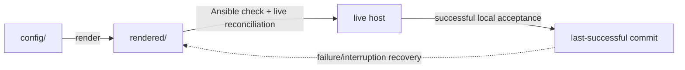
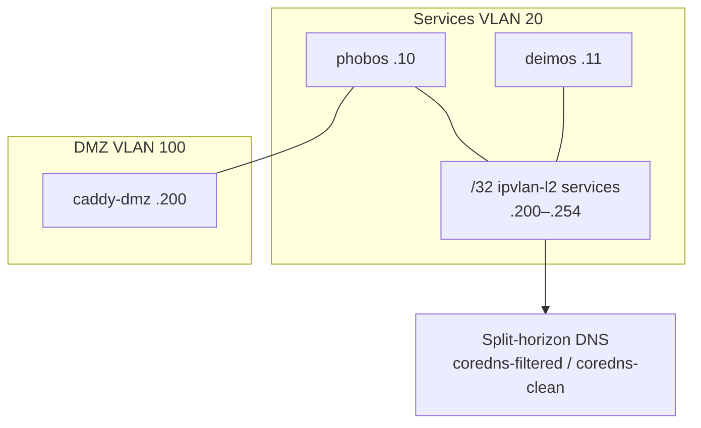

# Architecture

Abhaile is a GitOps-managed homelab running on two Debian 13 hosts (phobos, deimos). Desired state
lives in `config/`, is rendered into host-specific artifacts, and is reconciled by direct Ansible
resource-family roles.

## Pipeline

Render is unprivileged and deterministic. The runner performs Ansible check mode before live
reconciliation and advances recovery authority only after success.

### Deployment status

Both hosts use the existing runner, clone, lock, and `last-successful-commit` with direct Ansible
roles. The legacy Python mutation backend and applied-manifest history are retired. The same model
is used by scheduled reconciliation, fresh bootstrap, failure recovery, and pre-networkd recovery.

Registry-backed Quadlet containers render direct `.container` image references with
`Pull=missing`; normal boot uses local Podman storage and does not depend on registry DNS when the
desired image is already present. An unavailable missing image fails reconciliation and retains the
previous last-successful authority. Managed `.build` workflows verify their output and bounded
post-build result before consumers restart. Irreversible Podman/build residue is not described as
rolled back.

## Network Topology

Each containerized service gets a deterministic /32 address on ipvlan-l2. See [INVENTORY.md](INVENTORY.md) for the full address table.

## Secrets Flow

No secrets in git or rendered output. Vault Agent renders credentials at runtime to host-only paths.

## Key Components

| Layer | Role | Key paths |
|-------|------|-----------|
| Config | Source of truth | `config/mapping.yaml`, `config/network.yaml`, `config/services/*/service.yaml` |
| Render | Deterministic artifact generation | `src/abhaile/renderers/`, `src/abhaile/cli/render.py` |
| Reconcile | Direct Ansible resource-family convergence | `ansible/playbooks/reconcile.yml`, `ansible/roles/` |
| Removal evidence | Exact manifest/live identity classification | `src/abhaile/state/removals.py` |
| Runner | GitOps scheduling, fetch, rollback | `scripts/abhaile-runner` |
| Bootstrap | Fresh host enrollment | `scripts/bootstrap.sh` |

## Where to Look

| Topic | Reference |
|---|---|
| Reconciliation model | [README.md](../README.md) |
| Service-host mapping | [config/mapping.yaml](../config/mapping.yaml) |
| IP/VLAN assignments | [config/network.yaml](../config/network.yaml) |
| Adding or modifying a service | `config/services/<name>/service.yaml`, [ADR 0005](adr/0005-service-authoring-model.md) |
| Reconciliation | [Spec 0028](specs/accepted/0028-target-host-reconciliation-model.md), [ADR 0013](adr/0013-last-successful-ansible-reconciliation.md) |
| Secrets boundary | [ADR 0006](adr/0006-secrets-model-and-bootstrap-artifacts.md) |
| Rendering and validation | `make render`, portable `make validate`, host-local `make check HOST=<host>` |
| Spec status | [docs/specs/README.md](specs/README.md) |
| Operations runbook | [docs/runbooks/operations.md](runbooks/operations.md) |
| Emergency procedures | [docs/runbooks/break-glass.md](runbooks/break-glass.md) |
| Bootstrap a host | [docs/guides/bootstrap.md](guides/bootstrap.md) |
| Add a new service | [docs/guides/adding-a-service.md](guides/adding-a-service.md) |
| Credential reference | [docs/reference/secrets.md](reference/secrets.md) |
| Network inventory | [docs/INVENTORY.md](INVENTORY.md) |
