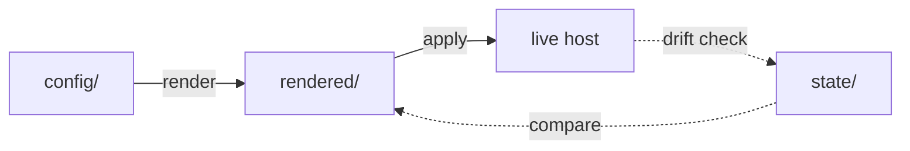
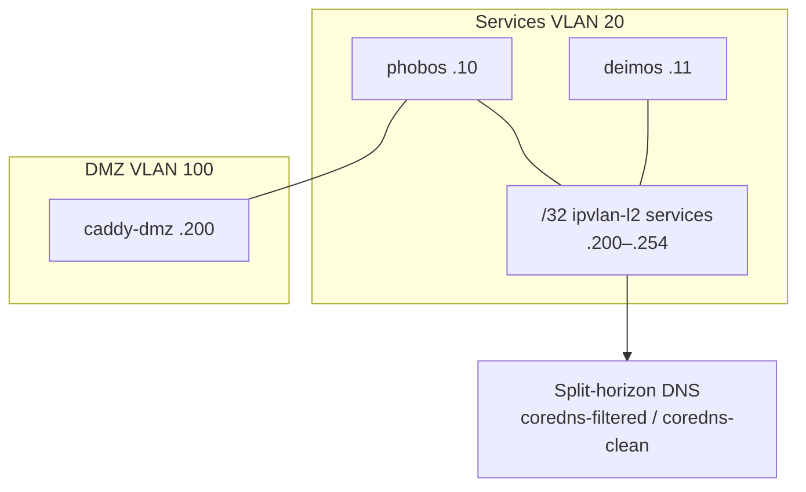
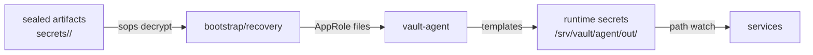

# Architecture

Abhaile is a GitOps-managed homelab running on two Debian 13 hosts (phobos, deimos). Desired state lives in `config/`, is rendered into host-specific artifacts, and applied with hash-based drift detection. The system converges hosts toward declared intent without manual changes.

## Pipeline

Render is unprivileged and deterministic. Apply is privileged, atomic, and defaults to dry-run. See [README](../README.md) for design principles.

### Migration status

The deployed hosts still use the legacy Python apply backend while the Ansible replacement is
reviewed and adopted one host at a time under active Spec 0028. The repository's replacement path
uses the existing runner, clone, lock, and `last-successful-commit`; direct Ansible roles replace
only manifest-v1 mutation. It introduces no second clone, capsule store, transaction coordinator,
or network-specific success protocol. Until an explicitly approved host cutover, operator apply
commands and recovery procedures must follow the legacy apply reference.

Registry-backed Quadlet containers render direct `.container` image references with
`Pull=missing`; normal boot uses local Podman storage and does not depend on registry DNS when the
desired image is already present. GitOps image changes are acquired transactionally by apply before
the new `.container` is staged or the service is restarted. Managed `.build` workflows are separate
transactions keyed by declared build input fingerprints; they use `Pull=missing` for missing base
images, verify the output image, run optional post-build actions, and restart consumers only after
the build transaction succeeds.

## Network Topology

Each containerized service gets a deterministic /32 address on ipvlan-l2. See [INVENTORY.md](INVENTORY.md) for the full address table.

## Secrets Flow

No secrets in git or rendered output. Vault Agent renders credentials at runtime to host-only paths.

## Key Components

| Layer | Role | Key paths |
|-------|------|-----------|
| Config | Source of truth | `config/mapping.yaml`, `config/network.yaml`, `config/services/*/service.yaml` |
| Render | Deterministic artifact generation | `src/abhaile/renderers/`, `src/abhaile/cli/render.py` |
| Apply (deployed) | Legacy host reconciliation with drift detection | `src/abhaile/apply/`, `src/abhaile/cli/apply.py` |
| Reconcile (migration) | Direct Ansible resource-family convergence | `ansible/playbooks/reconcile.yml`, `ansible/roles/` |
| Plan | Manifest comparison and owner ordering | `src/abhaile/plan/diff.py` |
| Runner | GitOps scheduling, fetch, rollback | `scripts/abhaile-runner` |
| Bootstrap | Fresh host enrollment | `scripts/bootstrap.sh` |

## Where to Look

| Topic | Reference |
|---|---|
| Reconciliation model | [README.md](../README.md) |
| Service-host mapping | [config/mapping.yaml](../config/mapping.yaml) |
| IP/VLAN assignments | [config/network.yaml](../config/network.yaml) |
| Adding or modifying a service | `config/services/<name>/service.yaml`, [ADR 0005](adr/0005-service-authoring-model.md) |
| Legacy apply phases | [Spec 0009](specs/accepted/0009-apply-pipeline.md) |
| Ansible migration | [Spec 0028](specs/active/0028-target-host-reconciliation-model.md), [ADR 0013](adr/0013-last-successful-ansible-reconciliation.md) |
| Secrets boundary | [ADR 0006](adr/0006-secrets-model-and-bootstrap-artifacts.md) |
| Running render/apply locally | `make render`, `make validate`, `make validate-host HOST=<host>` |
| Spec status | [docs/specs/README.md](specs/README.md) |
| Operations runbook | [docs/runbooks/operations.md](runbooks/operations.md) |
| Emergency procedures | [docs/runbooks/break-glass.md](runbooks/break-glass.md) |
| Bootstrap a host | [docs/guides/bootstrap.md](guides/bootstrap.md) |
| Add a new service | [docs/guides/adding-a-service.md](guides/adding-a-service.md) |
| Credential reference | [docs/reference/secrets.md](reference/secrets.md) |
| Network inventory | [docs/INVENTORY.md](INVENTORY.md) |
